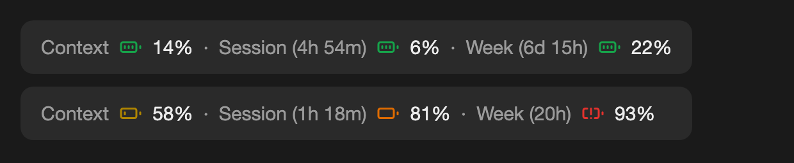
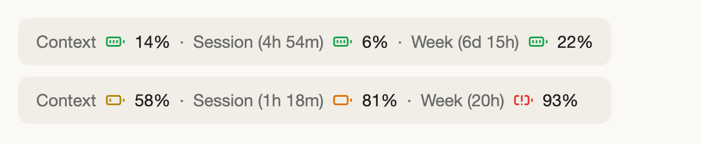
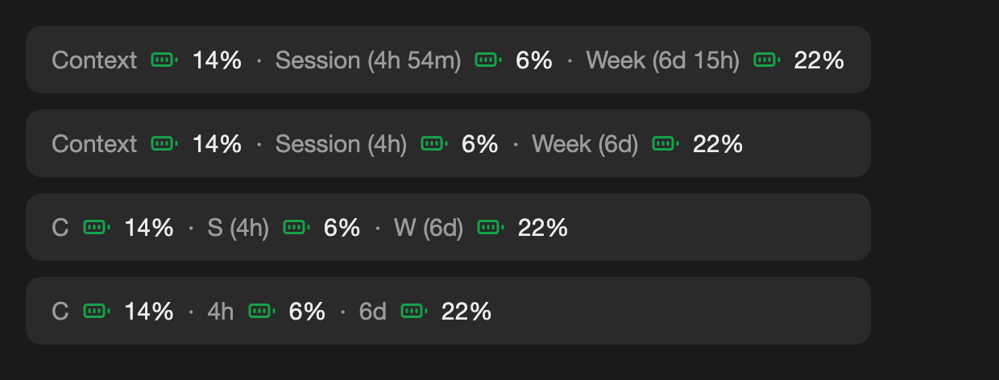
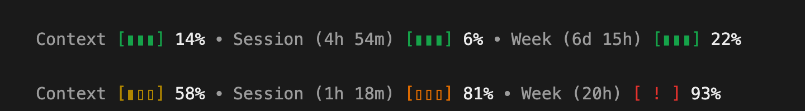

# Usage Battery

A Claude Code mod that shows your usage in one line above the prompt: how full the chat's context is, and how much of your 5-hour and weekly limits you've used, each as a coloured battery with the time left until it resets.





## What it shows

Each part reads `[name] [battery] [% used]`:

- **Context**: how full this chat's context window is.
- **Session (4h 54m)**: your 5-hour limit, and the time until it resets.
- **Week (6d 15h)**: your weekly limit, and the time until it resets.

The battery drains as you use more:

| Used | Battery | Colour |
|---|---|---|
| under 25% | full | green |
| 25–49% | two bars | green |
| 50–74% | one bar | yellow |
| 75–89% | empty | amber |
| 90% and up | warning | red |

Each colour has at least 3:1 contrast on light and dark backgrounds.

## It fits the space it has

The labels shorten as the window narrows:



## In the terminal

The terminal can't draw icons, so the battery is drawn with text:



## Install

From a terminal:

```bash
claude plugin install usage-battery --marketplace jevawin/usage-battery
```

Or at the Claude Code prompt:

```
/plugin install usage-battery --marketplace jevawin/usage-battery
```

It shows in new chats, in the desktop app and the terminal.

## Notes

- **Session and Week need a Claude subscription.** On an API key there are no limits to show, so only Context appears.
- **Limits appear after the first reply.** Claude Code learns them from its first response in a chat.
- **Context is a share of the whole window.** Claude Code's own "context left" notice counts towards the auto-compact point, which is lower, so the two can differ.
- **One band per chat.** Another mod that draws above the prompt competes for the same spot.
- The images are drawn by `scripts/readme-images.ts` from the mod's own layout code. They aren't screenshots of the app.

## Develop

```bash
claude plugin test .
```

`hooks/battery.ts` holds what the band shows: levels, colours, labels and layouts. `hooks/register.tsx` reads your usage and draws it. Run `node scripts/readme-images.ts` to redraw the images (needs Google Chrome).

Battery icons are from [Lucide](https://lucide.dev) (ISC licence).

## Licence

MIT
